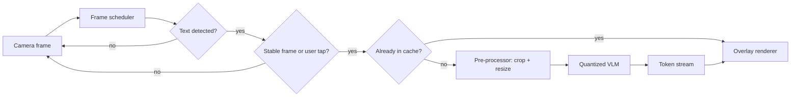
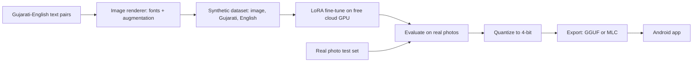

# Gujarati Lens (working title)

A camera app that translates Gujarati text to English in real time, using a **small vision-language model (VLM) running fully on the phone**.

> **Status:** planning / design phase. This README is the design document. Numbers marked `TBD` will be filled in after measurement.

---

## 1. Problem

Point your phone at Gujarati text (signboards, labels, menus, forms) and see the English translation on screen, quickly and without needing an internet connection.

## 2. Goals

- Open the camera on launch and translate Gujarati text found in view.
- Run the VLM **on-device** (offline, private, no server cost).
- Use a **small VLM fine-tuned for Gujarati to English**, instead of a large general model.
- Feel fast: show partial output as it is generated.
- Learn and document how to deploy a VLM on an edge device (quantization, runtimes, latency, memory).

## 3. Non-goals (for v1)

- Languages other than Gujarati to English.
- Perfect handwriting recognition.
- Video or document-length translation.
- Cloud fallback (may be added later).

---

## 4. High-level architecture

The app has four layers. Each layer talks only to the layer next to it, so parts can be swapped (a different model, a different runtime) without touching the UI.

| Layer | Components | Responsibility |
|---|---|---|
| Presentation | Camera preview, Overlay renderer, Controls | Show the camera feed and draw English text on top |
| App logic | Frame scheduler, Text detector, Result cache | Decide *when* to run the model and avoid repeat work |
| Inference | Pre-processor, VLM runtime, Prompt + decoder | Run the quantized VLM and stream the answer |
| Device | Camera sensor, CPU/NPU, Storage + RAM | Hardware the app runs on |

### Runtime flow (on the phone)



Only the cheap steps (scheduler, text detector) run on every frame. The heavy VLM runs only when needed. This is the main trick for keeping the app responsive on a CPU-only phone.

---

## 5. Components

### 5.1 Presentation layer

| Component | What it does | Tech (Android native) | Flutter alternative |
|---|---|---|---|
| Camera preview | Shows the live camera feed | CameraX (`Preview`, `PreviewView`) | `camera` package |
| Overlay renderer | Draws English text over the original Gujarati text | Jetpack Compose `Canvas` or custom `View.onDraw` | `Stack` + `CustomPaint` |
| Controls | Tap-to-translate, pause, settings | Jetpack Compose | Flutter widgets |

Note: placing text correctly needs the bounding box of the Gujarati text and a conversion from image coordinates to screen coordinates.

### 5.2 App logic layer

| Component | What it does | Tech (Android native) |
|---|---|---|
| Frame scheduler | Picks which frames to process, waits for a steady camera, allows only one translation at a time | CameraX `ImageAnalysis`, Kotlin coroutines, frame-difference check on small grayscale thumbnails (OpenCV optional) |
| Text detector | Fast check: is there text, and where? Detection only, no reading | Script-independent detector (for example PaddleOCR DBNet, EAST or CRAFT) converted to TFLite or ONNX |
| Result cache | Remembers recent translations so the same sign is not processed twice | `LruCache` / `HashMap` keyed by a perceptual hash of the crop; Room/SQLite only if a history screen is added |

> **Why not ML Kit text recognition?** Its camera text recognition covers Latin, Chinese, Devanagari, Japanese and Korean scripts, and Gujarati is not in that list. So the text detector must be a detection-only model, and the VLM does the actual reading. Verify against current ML Kit docs before relying on this.

### 5.3 Inference layer

| Component | What it does | Tech |
|---|---|---|
| Pre-processor | Crops to the text region and shrinks the image (fewer image tokens means lower latency) | Android `Bitmap` / `Matrix`, or OpenCV; keep aspect ratio |
| VLM runtime | Loads the model file and runs it on the device | **llama.cpp** via JNI (NDK + CMake) with a `.gguf` model and vision projector, **or** MLC LLM, **or** MediaPipe LLM Inference |
| Prompt + decoder | Sends the instruction and collects output token by token | Kotlin; stream tokens to the UI with `Flow` or callbacks; low temperature and capped output length |

Example prompt (to be tuned):

```
Read the Gujarati text in this image and translate it to English.
Output only the translation.
```

### 5.4 Device layer

Not built, but configured:

- **Model delivery:** bundle in the app, or download on first launch (Play Asset Delivery / `DownloadManager`).
- **Memory:** load the model once at startup and keep it in memory; use memory mapping where the runtime supports it.
- **Threads:** set the CPU thread count to match the target phone.
- **Testing:** use a mid-range phone, not only a flagship.

---

## 6. Model strategy

We use a **small VLM** and **fine-tune it** for Gujarati reading and translation.

### Candidate base models (to be evaluated)

| Model | Why consider it |
|---|---|
| SmolVLM (500M / 2B) | Very light, easy to fine-tune |
| Qwen2-VL 2B | Strong general OCR base |
| PaliGemma 3B | Multilingual pretraining, documented fine-tuning recipes |
| Gemma 3 / 3n | Broad language coverage, built with on-device use in mind |
| MiniCPM-V | Designed for phones, good OCR |

### Selection checklist

1. **Tokenizer efficiency for Gujarati.** Compare tokens per Gujarati sentence. More tokens means slower and worse output.
2. **Runtime support.** The model architecture must export to llama.cpp, MLC or MediaPipe. Check this before training.
3. **Zero-shot baseline.** Test each model on a small set of real Gujarati photos first.
4. **Size and speed.** Must fit in phone RAM after 4-bit quantization.

### Offline training pipeline



### Training data

- **Text source:** public Gujarati-English parallel corpora (for example Samanantar and BPCC from AI4Bharat, OPUS; FLORES for evaluation). Check each license.
- **Images:** render sentences with many Gujarati fonts, sizes, colors and backgrounds.
- **Augmentation:** blur, perspective warp, noise, shadows, low light, so images look like phone photos.
- **Extra labels:** where only Gujarati text exists, English labels can be generated with a strong translation model such as IndicTrans2.

### Training stages

1. **Reading:** image to Gujarati text (teaches the script).
2. **Translation:** image to English, or output both lines (`Gujarati: ... / English: ...`). Compare accuracy against latency.
3. **Method:** LoRA/QLoRA on Colab or Kaggle free GPUs. Save checkpoints to persistent storage.

### Biggest risk: the synthetic-to-real gap

A model trained only on rendered text can fail on real photos. A **held-out set of real photos** (signboards, labels, pages) is never used for training and is the only fair judge of quality.

---

## 7. Performance design

| Technique | Why it helps |
|---|---|
| Text detector gate | VLM sleeps when there is no text |
| Run on stable frame or tap | Avoids running on blurry frames |
| Crop to the text region | Fewer pixels means fewer image tokens |
| Lower image resolution | Biggest single lever on latency |
| 4-bit quantization | Smaller model, faster, less RAM |
| Token streaming | User sees output start immediately |
| Result cache | No repeated work for the same sign |
| One translation at a time | Drop or replace requests; never queue frames |
| Background thread for inference | UI and camera never freeze |

---

## 8. Evaluation

| Metric | Measures | Target |
|---|---|---|
| Character error rate (CER) | How well Gujarati text is read | TBD |
| chrF++ | English translation quality | TBD |
| Time to first token | How fast output starts | TBD |
| Total latency per translation | How fast it finishes | TBD |
| Tokens per second | Model speed on the device | TBD |
| Peak RAM | Memory use | TBD |
| Battery drain | Cost of running continuously | TBD |

Report results as a table: **model × quantization level × device**, plus a zero-shot baseline vs fine-tuned comparison.

---

## 9. Tech stack summary

| Area | Choice |
|---|---|
| Language / platform | Kotlin, Android (Flutter is an option, but needs native bridges for the heaviest parts) |
| UI | Jetpack Compose |
| Camera | CameraX |
| Concurrency | Kotlin coroutines and Flow |
| Text detection | TFLite or ONNX Runtime with a detection-only model |
| VLM runtime | llama.cpp (JNI) as the primary option; MLC LLM as an alternative |
| Training | Python, Hugging Face `transformers` / `peft`, Colab or Kaggle GPU |
| Tooling | Android Studio, NDK, CMake, Android Studio Profiler |

---

## 10. Suggested project structure

```
gujarati-lens/
├── app/                              # Android app
│   └── src/main/
│       ├── java/.../ui/              # CameraScreen, OverlayView, Controls
│       ├── java/.../logic/           # FrameScheduler, TextDetector, ResultCache
│       ├── java/.../inference/       # Translator (interface), VlmTranslator,
│       │                             # FakeTranslator, Preprocessor, PromptBuilder
│       └── cpp/                      # JNI bridge to llama.cpp, CMakeLists.txt
├── training/
│   ├── data_gen/                     # text-to-image renderer + augmentation
│   ├── finetune/                     # LoRA training notebooks/scripts
│   ├── eval/                         # CER, chrF++, latency benchmarks
│   └── export/                       # quantization + GGUF/MLC export
├── data/
│   └── real_photos_test/             # held-out real photos (never train on this)
├── docs/                             # diagrams, benchmark results
└── README.md
```

### Key interface

```kotlin
interface Translator {
    // Takes a cropped image, streams back English text as it is generated.
    fun translate(image: Bitmap): Flow<String>
}
```

Build against `FakeTranslator` first so the whole app works before the real model is ready.

---

## 11. Roadmap

- [ ] **Phase 0: Feasibility.** Collect ~30-100 real Gujarati photos. Test candidate VLMs zero-shot on a laptop (check tokenizer cost and quality).
- [ ] **Phase 1: App skeleton.** Camera preview, overlay, `FakeTranslator`, frame scheduler.
- [ ] **Phase 2: Text gate.** Add the detection-only text detector and crop logic.
- [ ] **Phase 3: Data + fine-tune.** Build the synthetic data generator, LoRA fine-tune, evaluate on real photos.
- [ ] **Phase 4: Edge deployment.** Quantize, export, integrate llama.cpp (or MLC) via JNI, stream tokens.
- [ ] **Phase 5: Optimize.** Tune resolution, threads, prompt, cache; fill in the benchmark table.
- [ ] **Phase 6 (optional).** Offline polish, history screen, tap-to-explain mode, extra languages.

---

## 12. Risks and open questions

| Risk | Mitigation |
|---|---|
| Small VLMs read Gujarati poorly | Fine-tune on synthetic data; choose a base with a Gujarati-friendly tokenizer |
| Synthetic data does not match real photos | Heavy augmentation; add some real photos to training; judge only on held-out real photos |
| Too slow on a CPU-only phone | Text gate, tap-to-translate, smaller crop, lower resolution, smaller model |
| Chosen model cannot be exported to the runtime | Verify runtime support before fine-tuning |
| Overlay misaligned with real text | Test coordinate mapping early; consider showing a translation card instead of in-place overlay |
| Dataset license limits | Check licenses before using or redistributing any data |

Open questions:
- Android native or Flutter? (Native recommended for control over performance.)
- Output both Gujarati and English, or English only?
- Bundle the model in the app, or download on first launch?

---

## 13. License

TBD. Check the licenses of the base model and training datasets before choosing one.
